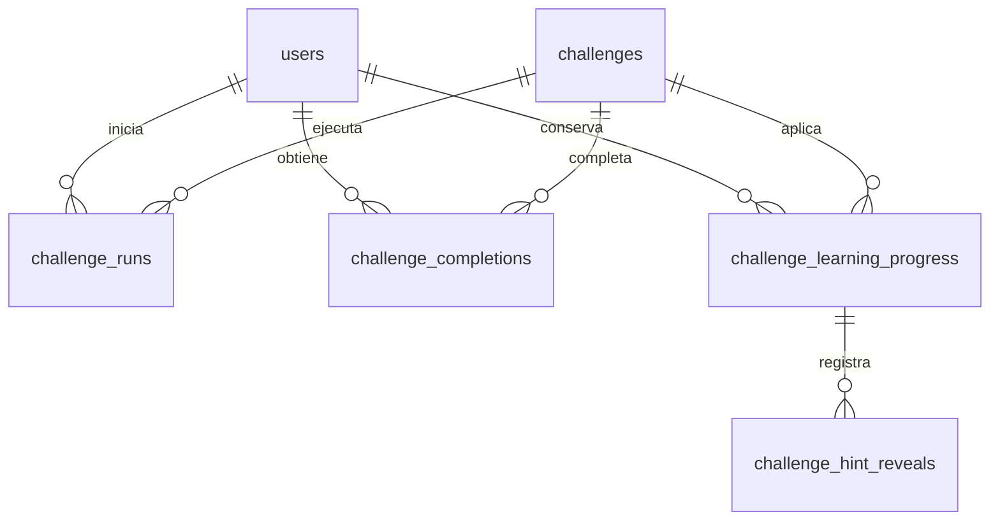

# Esquema de datos de Cociber CTF

La plataforma utiliza **PostgreSQL 16** para sus datos persistentes y **Redis** para coordinación y sesiones efímeras. Este paquete entrega el esquema vacío de PostgreSQL, reproducido del ORM actual de la plataforma. No contiene cuentas, contraseñas, retos, flags, estudiantes ni puntajes de la instalación de origen.

## Fuentes y alcance

- `backend/app/models.py`: **19 tablas**, sus columnas, claves, restricciones e índices ORM.
- `backend/app/db.py`: dos índices únicos parciales adicionales creados en una instalación nueva: `uq_laboratories_code` y `uq_student_groups_guacamole_identifier`. Los demás índices de compatibilidad ya están representados por el ORM.
- `backend/migrate_learning.py` y `backend/migrate_learning_policy.py`: sus cambios actuales ya están incluidos en los modelos: tablas de progreso/pistas, `learning_policy`, `policy_snapshot` y descuento de pistas entre 0 y 100.

Los hashes de ambos archivos de origen aparecen en [01_schema.sql](../sql/01_schema.sql). Este archivo corresponde a una instalación nueva. No sustituye una migración ni un respaldo de una base existente; no se deben ejecutar los scripts iniciales sobre la base actual de los estudiantes.

## Archivos y orden de instalación

| Archivo | Conexión | Resultado |
|---|---|---|
| [00_roles.sql](../sql/00_roles.sql) | Administrador local de PostgreSQL, base `postgres` | Crea `cociberctf` como administrador **SUPERUSER** y propietario de la base `cociber_ctf`. Lee `PG_ADMIN_PASSWORD` del entorno privado. |
| [01_schema.sql](../sql/01_schema.sql) | Administrador local o `cociberctf`, base `cociber_ctf` | Crea las 19 tablas vacías, sus secuencias, índices y restricciones como propietario `cociberctf`. |
| [02_runtime.sql](../sql/02_runtime.sql) | Administrador local de PostgreSQL, base `cociber_ctf` | Crea `cociber_app` con permisos DML y uso de secuencias, sin SUPERUSER ni permisos para modificar el esquema. Lee `PG_APP_PASSWORD` del entorno privado. |
| [03_bootstrap_roles.sql](../sql/03_bootstrap_roles.sql) | Administrador o cuenta DML, base `cociber_ctf` | **Opcional:** inserta únicamente las etiquetas `admin`, `instructor`, `player`, `guest` en `roles`. No crea usuarios de acceso. |

Los scripts de contraseñas reciben los secretos con `psql` mediante `\getenv`. No hay una contraseña literal en estos archivos ni se necesita pasarla como argumento. El procedimiento de PostgreSQL de este paquete prepara y conserva el archivo privado de credenciales fuera de Git.

`00_roles.sql` exige roles/base nuevos. PostgreSQL no permite `CREATE DATABASE` dentro de una transacción; si falla esa última operación, el administrador debe revisar el estado antes de repetir. Los scripts no eliminan ni restablecen objetos existentes. `01_schema.sql` comprueba que la base sea `cociber_ctf` y que `public` esté vacío; si encuentra objetos, detiene toda la transacción. No usa `IF NOT EXISTS` para ocultar diferencias de esquema.

El backend debe conectarse como `cociber_app` y mantener **`MANAGE_SCHEMA_ON_STARTUP=false`**. El código actual solo ejecuta `create_schema` y `seed_data` cuando esa opción se activa expresamente. Las migraciones se ejecutan por separado con la cuenta administrativa. El administrador PostgreSQL y el administrador de la aplicación son identidades diferentes: el primero no permite iniciar sesión en la interfaz web.

## Relaciones principales

Este diagrama resume el aprendizaje y la puntuación; las relaciones restantes figuran en la tabla siguiente y en el diccionario completo.



## Tablas y finalidad

Todas las tablas tienen una clave primaria entera `id`. Las claves foráneas que siguen son restricciones reales; `users.role` es una cadena y **no** tiene una FK hacia `roles`.

| Tabla | Finalidad | Claves foráneas |
|---|---|---|
| `roles` | Catálogo de roles funcionales de la aplicación. | Ninguna. |
| `users` | Identidad, hash de contraseña, rol y estado del usuario. | Ninguna. |
| `challenges` | Catálogo del reto, instrucciones, puntos y política de ayudas. | `created_by → users.id`. |
| `challenge_flags` | Validadores de flags, orden, modo y plantilla. | `challenge_id → challenges.id`. |
| `challenge_runs` | Una ejecución del reto: estudiante, inicio, vencimiento y cierre. | `user_id → users.id`; `challenge_id → challenges.id`. |
| `challenge_run_flags` | Hashes de flags asociados a una ejecución concreta. | `run_id → challenge_runs.id`; `flag_id → challenge_flags.id`. |
| `submissions` | Intentos de respuesta y su resultado; guarda HMAC, no la respuesta original. | `user_id → users.id`; `challenge_id → challenges.id`; `flag_id → challenge_flags.id`. |
| `challenge_completions` | Finalización única por estudiante/reto y puntos obtenidos. Es la fuente del ranking. | `user_id → users.id`; `challenge_id → challenges.id`. |
| `challenge_learning_progress` | Primer plazo, puntos base, instantánea de política y solución revelada. | `user_id → users.id`; `challenge_id → challenges.id`; `first_run_id → challenge_runs.id`. |
| `challenge_hint_reveals` | Pistas solicitadas y descuento registrado en cada revelación. | `progress_id → challenge_learning_progress.id`; `run_id → challenge_runs.id`. |
| `remote_access_assignments` | Referencia y URL de acceso remoto de una ejecución. | `run_id → challenge_runs.id`. |
| `challenge_instances` | Reserva y estado de una VM reutilizable del pool. | `challenge_id → challenges.id`; `vm_asset_id → vm_assets.id`; `run_id → challenge_runs.id`; `user_id → users.id`. |
| `laboratories` | Agrupación e inventario de laboratorios. | Ninguna. |
| `vm_assets` | Sistema, red, IP y referencias de Guacamole/hipervisor de cada VM. | `laboratory_id → laboratories.id`. |
| `reset_operations` | Historial de solicitudes y resultados de restauración. | `laboratory_id → laboratories.id`; `requested_by → users.id`. |
| `student_groups` | Grupos de estudiantes y referencia de grupo en Guacamole. | `created_by → users.id`. |
| `group_memberships` | Pertenencia de usuarios a grupos. | `group_id → student_groups.id`; `user_id → users.id`. |
| `challenge_group_assignments` | Retos disponibles para cada grupo. | `challenge_id → challenges.id`; `group_id → student_groups.id`; `created_by → users.id`. |
| `audit_events` | Actor, acción, entidad, fecha y detalles de auditoría. | `actor_id → users.id`. |

## Restricciones que conservan la coherencia

- Una sola finalización por `(user_id, challenge_id)` en `challenge_completions` evita otorgar dos veces los puntos del mismo reto.
- Una sola política de progreso por `(user_id, challenge_id)` conserva el primer plazo y la política asignada. Una pista solo puede revelarse una vez por `(progress_id, hint_id)`.
- `hint_id` está entre 1 y 3; `penalty_percent`, entre 0 y 100; `base_points` no puede ser negativo.
- Una flag de una ejecución es única por `(run_id, flag_id)`. El acceso remoto y la instancia del pool admiten una sola asignación por ejecución.
- Las pertenencias y asignaciones a grupos no pueden duplicarse. Usuarios, códigos y los identificadores de integración indicados en el diccionario tienen restricciones únicas.
- `ON DELETE CASCADE` elimina dependencias indicadas en el diccionario; `SET NULL` conserva la fila dependiente sin esa referencia. Las FK sin acción especificada utilizan `NO ACTION`. No se añade un borrado general de usuarios ni de historial.

El SQL conserva los tipos reales del ORM: los documentos son `JSON`, las fechas tienen zona horaria y los identificadores usan `SERIAL`. Los valores `default=` de Python no se convierten artificialmente en valores `DEFAULT` de PostgreSQL. Del mismo modo, `updated_at` utiliza el mecanismo `onupdate` de SQLAlchemy; este paquete no inventa un trigger de base de datos.

## Datos sensibles y separación de servicios

| Ubicación | Datos que requieren protección |
|---|---|
| `users` | Hash de contraseña, correo, nombre y organización. |
| `challenge_flags`, `challenge_run_flags` | Hashes y plantillas de validación; no publicarlos en catálogos de estudiantes. |
| `challenges.learning_policy`, `challenge_learning_progress.policy_snapshot` | Pistas y explicación de solución que el backend revela según la política. |
| `submissions` | HMAC de respuestas e historial del estudiante; requiere conservar el secreto HMAC externo para validar coherencia. |
| `remote_access_assignments`, `vm_assets`, `challenge_instances` | Referencias de conexión, URLs y topología del laboratorio. |
| `audit_events.details` | Detalles internos de acciones e integración; revisar antes de exportar. |

PostgreSQL conserva usuarios, catálogo, grupos, ejecuciones, resultados, puntuaciones, inventario y auditoría. **Redis no sustituye esas tablas**: almacena límites temporales de intentos, reservas/leases de VMs, tickets de terminal de un solo uso, marcas de cierre y sesiones delegadas de Guacamole cifradas y con caducidad. También distribuye notificaciones del ranking. Los secretos JWT/HMAC, contraseñas de conexión y credenciales de servicios pertenecen a archivos privados del despliegue, no a este esquema SQL.

El portal ficticio **Operación Cóndor es otra aplicación**, alojada en la VM víctima. Usa su propio archivo **SQLite** con `users`, `lab_settings` y `announcements`. Sus tablas, cuenta vulnerable y flag del ejercicio **no se importan a PostgreSQL**. La coincidencia del nombre `users` no representa una relación ni una sincronización entre ambas bases. Guacamole puede tener además su propia base de datos de servicio, igualmente separada.

## Reproducir y comprobar este esquema

Ejecutar [generate_schema.py](../tools/generate_schema.py) con Python y la versión de SQLAlchemy del backend. No necesita red ni una conexión a PostgreSQL; importa solamente el archivo de modelos y lee la compatibilidad de `db.py`.

```bash
python tools/generate_schema.py \
  --models /ruta/ctf_project/backend/app/models.py \
  --output sql/01_schema.sql \
  --dictionary-output docs/04_ESQUEMA_BASE_DATOS.md

python tools/generate_schema.py \
  --models /ruta/ctf_project/backend/app/models.py \
  --output sql/01_schema.sql \
  --dictionary-output docs/04_ESQUEMA_BASE_DATOS.md \
  --check
```

El generador conserva esta explicación y reemplaza únicamente el bloque de diccionario que sigue. La comprobación debe ejecutarse contra la misma revisión del código fuente y de sus dependencias. Un esquema de una instalación anterior debe compararse y migrarse explícitamente; este generador no consulta ni transforma datos existentes.

<!-- BEGIN GENERATED ORM DICTIONARY -->

## Diccionario de columnas

Generado desde el mismo ORM que el SQL. `Python` indica un valor aplicado por SQLAlchemy; no es un `DEFAULT` del servidor.

### `audit_events`

| Campo | PostgreSQL | NULL | Predeterminado | Claves y relaciones |
|---|---|---|---|---|
| `id` | `INTEGER` | No | — | PK; SERIAL |
| `actor_id` | `INTEGER` | Sí | — | FK → `users.id`; DELETE NO ACTION |
| `action` | `VARCHAR(120)` | No | — | — |
| `entity_type` | `VARCHAR(64)` | No | — | — |
| `entity_id` | `VARCHAR(64)` | No | — | — |
| `details` | `JSON` | No | `dict()` (Python) | — |
| `created_at` | `TIMESTAMP WITH TIME ZONE` | No | `now()` (servidor) | — |

### `challenge_completions`

| Campo | PostgreSQL | NULL | Predeterminado | Claves y relaciones |
|---|---|---|---|---|
| `id` | `INTEGER` | No | — | PK; SERIAL |
| `user_id` | `INTEGER` | No | — | FK → `users.id`; DELETE NO ACTION |
| `challenge_id` | `INTEGER` | No | — | FK → `challenges.id`; DELETE NO ACTION |
| `completed_at` | `TIMESTAMP WITH TIME ZONE` | No | `now()` (servidor) | — |
| `awarded_points` | `INTEGER` | No | — | — |

Restricciones adicionales: `UNIQUE (user_id, challenge_id)`.

### `challenge_flags`

| Campo | PostgreSQL | NULL | Predeterminado | Claves y relaciones |
|---|---|---|---|---|
| `id` | `INTEGER` | No | — | PK; SERIAL |
| `challenge_id` | `INTEGER` | No | — | FK → `challenges.id`; DELETE CASCADE |
| `label` | `VARCHAR(120)` | No | — | — |
| `flag_hash` | `VARCHAR(512)` | Sí | — | — |
| `validator` | `VARCHAR(32)` | No | `'exact_hash'` (Python) | — |
| `mode` | `VARCHAR(16)` | No | `'static'` (Python) | — |
| `template` | `VARCHAR(512)` | Sí | — | — |
| `flag_order` | `INTEGER` | No | `1` (Python) | — |
| `is_active` | `BOOLEAN` | No | `False` (Python) | — |

### `challenge_group_assignments`

| Campo | PostgreSQL | NULL | Predeterminado | Claves y relaciones |
|---|---|---|---|---|
| `id` | `INTEGER` | No | — | PK; SERIAL |
| `challenge_id` | `INTEGER` | No | — | FK → `challenges.id`; DELETE CASCADE |
| `group_id` | `INTEGER` | No | — | FK → `student_groups.id`; DELETE CASCADE |
| `created_by` | `INTEGER` | Sí | — | FK → `users.id`; DELETE NO ACTION |
| `created_at` | `TIMESTAMP WITH TIME ZONE` | No | `now()` (servidor) | — |

Restricciones adicionales: `UNIQUE (challenge_id, group_id)`.

### `challenge_hint_reveals`

| Campo | PostgreSQL | NULL | Predeterminado | Claves y relaciones |
|---|---|---|---|---|
| `id` | `INTEGER` | No | — | PK; SERIAL |
| `progress_id` | `INTEGER` | No | — | FK → `challenge_learning_progress.id`; DELETE CASCADE |
| `run_id` | `INTEGER` | Sí | — | FK → `challenge_runs.id`; DELETE SET NULL |
| `hint_id` | `INTEGER` | No | — | — |
| `penalty_percent` | `INTEGER` | No | `10` (Python) | — |
| `revealed_at` | `TIMESTAMP WITH TIME ZONE` | No | `now()` (servidor) | — |

Restricciones adicionales: `ck_learning_hint_id: CHECK (hint_id >= 1 AND hint_id <= 3)`; `ck_learning_hint_penalty: CHECK (penalty_percent >= 0 AND penalty_percent <= 100)`; `UNIQUE (progress_id, hint_id)`.

### `challenge_instances`

| Campo | PostgreSQL | NULL | Predeterminado | Claves y relaciones |
|---|---|---|---|---|
| `id` | `INTEGER` | No | — | PK; SERIAL |
| `challenge_id` | `INTEGER` | No | — | FK → `challenges.id`; DELETE CASCADE |
| `vm_asset_id` | `INTEGER` | No | — | FK → `vm_assets.id`; DELETE CASCADE |
| `run_id` | `INTEGER` | Sí | — | FK → `challenge_runs.id`; DELETE SET NULL |
| `user_id` | `INTEGER` | Sí | — | FK → `users.id`; DELETE SET NULL |
| `state` | `VARCHAR(20)` | No | `'disponible'` (Python) | — |
| `ip_address` | `VARCHAR(64)` | Sí | — | — |
| `guacamole_connection_id` | `VARCHAR(160)` | Sí | — | — |
| `guacamole_access_granted` | `BOOLEAN` | No | `False` (Python) | — |
| `guacamole_access_preexisting` | `BOOLEAN` | No | `False` (Python) | — |
| `reserved_at` | `TIMESTAMP WITH TIME ZONE` | Sí | — | — |
| `expires_at` | `TIMESTAMP WITH TIME ZONE` | Sí | — | — |
| `last_error` | `VARCHAR(500)` | Sí | — | — |
| `created_at` | `TIMESTAMP WITH TIME ZONE` | No | `now()` (servidor) | — |
| `updated_at` | `TIMESTAMP WITH TIME ZONE` | No | `now()` (servidor) | — |

Restricciones adicionales: `UNIQUE (run_id)`.

### `challenge_learning_progress`

| Campo | PostgreSQL | NULL | Predeterminado | Claves y relaciones |
|---|---|---|---|---|
| `id` | `INTEGER` | No | — | PK; SERIAL |
| `user_id` | `INTEGER` | No | — | FK → `users.id`; DELETE CASCADE |
| `challenge_id` | `INTEGER` | No | — | FK → `challenges.id`; DELETE CASCADE |
| `first_run_id` | `INTEGER` | Sí | — | FK → `challenge_runs.id`; DELETE SET NULL |
| `policy_version` | `INTEGER` | No | `1` (Python) | — |
| `policy_snapshot` | `JSON` | Sí | — | — |
| `base_points` | `INTEGER` | No | — | — |
| `deadline` | `TIMESTAMP WITH TIME ZONE` | No | — | — |
| `solution_revealed_at` | `TIMESTAMP WITH TIME ZONE` | Sí | — | — |
| `is_assisted` | `BOOLEAN` | No | `False` (Python) | — |
| `created_at` | `TIMESTAMP WITH TIME ZONE` | No | `now()` (servidor) | — |

Restricciones adicionales: `ck_learning_base_points: CHECK (base_points >= 0)`; `UNIQUE (user_id, challenge_id)`.

### `challenge_run_flags`

| Campo | PostgreSQL | NULL | Predeterminado | Claves y relaciones |
|---|---|---|---|---|
| `id` | `INTEGER` | No | — | PK; SERIAL |
| `run_id` | `INTEGER` | No | — | FK → `challenge_runs.id`; DELETE CASCADE |
| `flag_id` | `INTEGER` | No | — | FK → `challenge_flags.id`; DELETE CASCADE |
| `flag_hash` | `VARCHAR(512)` | No | — | — |
| `fingerprint` | `VARCHAR(64)` | No | — | — |
| `created_at` | `TIMESTAMP WITH TIME ZONE` | No | `now()` (servidor) | — |

Restricciones adicionales: `UNIQUE (run_id, flag_id)`.

### `challenge_runs`

| Campo | PostgreSQL | NULL | Predeterminado | Claves y relaciones |
|---|---|---|---|---|
| `id` | `INTEGER` | No | — | PK; SERIAL |
| `user_id` | `INTEGER` | No | — | FK → `users.id`; DELETE NO ACTION |
| `challenge_id` | `INTEGER` | No | — | FK → `challenges.id`; DELETE NO ACTION |
| `status` | `VARCHAR(32)` | No | `'active'` (Python) | — |
| `workspace_strategy` | `VARCHAR(32)` | No | `'per_user_account'` (Python) | — |
| `started_at` | `TIMESTAMP WITH TIME ZONE` | No | `now()` (servidor) | — |
| `expires_at` | `TIMESTAMP WITH TIME ZONE` | No | — | — |
| `closed_at` | `TIMESTAMP WITH TIME ZONE` | Sí | — | — |

### `challenges`

| Campo | PostgreSQL | NULL | Predeterminado | Claves y relaciones |
|---|---|---|---|---|
| `id` | `INTEGER` | No | — | PK; SERIAL |
| `code` | `VARCHAR(64)` | No | — | UNIQUE |
| `name` | `VARCHAR(160)` | No | — | — |
| `description` | `TEXT` | No | — | — |
| `instructions` | `TEXT` | No | `''` (Python) | — |
| `difficulty` | `VARCHAR(16)` | No | — | — |
| `category` | `VARCHAR(48)` | No | `'MISC'` (Python) | — |
| `scenario` | `VARCHAR(64)` | Sí | — | — |
| `mitre_technique` | `VARCHAR(64)` | No | — | — |
| `asset_references` | `JSON` | No | `list()` (Python) | — |
| `points` | `INTEGER` | No | — | — |
| `learning_policy` | `JSON` | Sí | — | — |
| `is_published` | `BOOLEAN` | No | `True` (Python) | — |
| `created_by` | `INTEGER` | Sí | — | FK → `users.id`; DELETE NO ACTION |
| `created_at` | `TIMESTAMP WITH TIME ZONE` | No | `now()` (servidor) | — |

### `group_memberships`

| Campo | PostgreSQL | NULL | Predeterminado | Claves y relaciones |
|---|---|---|---|---|
| `id` | `INTEGER` | No | — | PK; SERIAL |
| `group_id` | `INTEGER` | No | — | FK → `student_groups.id`; DELETE CASCADE |
| `user_id` | `INTEGER` | No | — | FK → `users.id`; DELETE CASCADE |
| `created_at` | `TIMESTAMP WITH TIME ZONE` | No | `now()` (servidor) | — |

Restricciones adicionales: `UNIQUE (group_id, user_id)`.

### `laboratories`

| Campo | PostgreSQL | NULL | Predeterminado | Claves y relaciones |
|---|---|---|---|---|
| `id` | `INTEGER` | No | — | PK; SERIAL |
| `code` | `VARCHAR(64)` | Sí | — | UNIQUE |
| `name` | `VARCHAR(120)` | No | — | UNIQUE |
| `description` | `VARCHAR(300)` | No | `''` (Python) | — |
| `segment` | `VARCHAR(64)` | No | `'VLAN 30'` (Python) | — |
| `status` | `VARCHAR(32)` | No | `'planned'` (Python) | — |
| `created_at` | `TIMESTAMP WITH TIME ZONE` | No | `now()` (servidor) | — |

### `remote_access_assignments`

| Campo | PostgreSQL | NULL | Predeterminado | Claves y relaciones |
|---|---|---|---|---|
| `id` | `INTEGER` | No | — | PK; SERIAL |
| `run_id` | `INTEGER` | No | — | UNIQUE; FK → `challenge_runs.id`; DELETE CASCADE |
| `provider` | `VARCHAR(32)` | No | `'guacamole'` (Python) | — |
| `external_reference` | `VARCHAR(160)` | No | — | UNIQUE |
| `launch_url` | `VARCHAR(1024)` | No | — | — |
| `status` | `VARCHAR(32)` | No | `'active'` (Python) | — |
| `expires_at` | `TIMESTAMP WITH TIME ZONE` | No | — | — |

Restricciones adicionales: `UNIQUE (external_reference)`; `UNIQUE (run_id)`.

### `reset_operations`

| Campo | PostgreSQL | NULL | Predeterminado | Claves y relaciones |
|---|---|---|---|---|
| `id` | `INTEGER` | No | — | PK; SERIAL |
| `laboratory_id` | `INTEGER` | No | — | FK → `laboratories.id`; DELETE CASCADE |
| `requested_by` | `INTEGER` | Sí | — | FK → `users.id`; DELETE NO ACTION |
| `scope` | `VARCHAR(32)` | No | `'baseline'` (Python) | — |
| `reason` | `VARCHAR(300)` | No | `'Reset solicitado por administrador'` (Python) | — |
| `status` | `VARCHAR(32)` | No | `'requested'` (Python) | — |
| `started_at` | `TIMESTAMP WITH TIME ZONE` | Sí | — | — |
| `completed_at` | `TIMESTAMP WITH TIME ZONE` | Sí | — | — |
| `message` | `VARCHAR(500)` | No | `''` (Python) | — |
| `created_at` | `TIMESTAMP WITH TIME ZONE` | No | `now()` (servidor) | — |

### `roles`

| Campo | PostgreSQL | NULL | Predeterminado | Claves y relaciones |
|---|---|---|---|---|
| `id` | `INTEGER` | No | — | PK; SERIAL |
| `name` | `VARCHAR(32)` | No | — | UNIQUE |
| `description` | `VARCHAR(160)` | No | — | — |

Restricciones adicionales: `UNIQUE (name)`.

### `student_groups`

| Campo | PostgreSQL | NULL | Predeterminado | Claves y relaciones |
|---|---|---|---|---|
| `id` | `INTEGER` | No | — | PK; SERIAL |
| `name` | `VARCHAR(120)` | No | — | — |
| `code` | `VARCHAR(64)` | No | — | UNIQUE |
| `description` | `VARCHAR(300)` | No | `''` (Python) | — |
| `is_active` | `BOOLEAN` | No | `True` (Python) | — |
| `guacamole_group_identifier` | `VARCHAR(128)` | Sí | — | UNIQUE |
| `created_by` | `INTEGER` | Sí | — | FK → `users.id`; DELETE NO ACTION |
| `created_at` | `TIMESTAMP WITH TIME ZONE` | No | `now()` (servidor) | — |

Restricciones adicionales: `UNIQUE (guacamole_group_identifier)`; `UNIQUE (name)`.

### `submissions`

| Campo | PostgreSQL | NULL | Predeterminado | Claves y relaciones |
|---|---|---|---|---|
| `id` | `INTEGER` | No | — | PK; SERIAL |
| `user_id` | `INTEGER` | No | — | FK → `users.id`; DELETE NO ACTION |
| `challenge_id` | `INTEGER` | No | — | FK → `challenges.id`; DELETE NO ACTION |
| `flag_id` | `INTEGER` | Sí | — | FK → `challenge_flags.id`; DELETE NO ACTION |
| `submitted_value_hmac` | `VARCHAR(64)` | No | — | — |
| `is_correct` | `BOOLEAN` | No | `False` (Python) | — |
| `submitted_at` | `TIMESTAMP WITH TIME ZONE` | No | `now()` (servidor) | — |

### `users`

| Campo | PostgreSQL | NULL | Predeterminado | Claves y relaciones |
|---|---|---|---|---|
| `id` | `INTEGER` | No | — | PK; SERIAL |
| `username` | `VARCHAR(64)` | No | — | UNIQUE |
| `email` | `VARCHAR(255)` | Sí | — | UNIQUE |
| `password_hash` | `VARCHAR(512)` | No | — | — |
| `role` | `VARCHAR(32)` | No | — | — |
| `full_name` | `VARCHAR(160)` | Sí | — | — |
| `organization` | `VARCHAR(160)` | Sí | — | — |
| `user_function` | `VARCHAR(80)` | Sí | — | — |
| `is_active` | `BOOLEAN` | No | `True` (Python) | — |
| `created_at` | `TIMESTAMP WITH TIME ZONE` | No | `now()` (servidor) | — |

Restricciones adicionales: `UNIQUE (email)`.

### `vm_assets`

| Campo | PostgreSQL | NULL | Predeterminado | Claves y relaciones |
|---|---|---|---|---|
| `id` | `INTEGER` | No | — | PK; SERIAL |
| `laboratory_id` | `INTEGER` | No | — | FK → `laboratories.id`; DELETE CASCADE |
| `name` | `VARCHAR(120)` | No | — | — |
| `os` | `VARCHAR(120)` | No | `'Por definir'` (Python) | — |
| `ip_address` | `VARCHAR(64)` | Sí | — | — |
| `vlan` | `VARCHAR(32)` | No | `'VLAN 30'` (Python) | — |
| `role` | `VARCHAR(120)` | No | `'Máquina de laboratorio'` (Python) | — |
| `network_role` | `VARCHAR(64)` | No | `'Víctimas'` (Python) | — |
| `subnet` | `VARCHAR(64)` | No | `'10.10.30.0/24'` (Python) | — |
| `profile` | `VARCHAR(32)` | No | `'standard'` (Python) | — |
| `baseline` | `VARCHAR(160)` | Sí | — | — |
| `nutanix_vm_id` | `VARCHAR(160)` | Sí | — | — |
| `guacamole_connection_id` | `VARCHAR(160)` | Sí | — | — |
| `status` | `VARCHAR(32)` | No | `'planned'` (Python) | — |
| `created_at` | `TIMESTAMP WITH TIME ZONE` | No | `now()` (servidor) | — |
